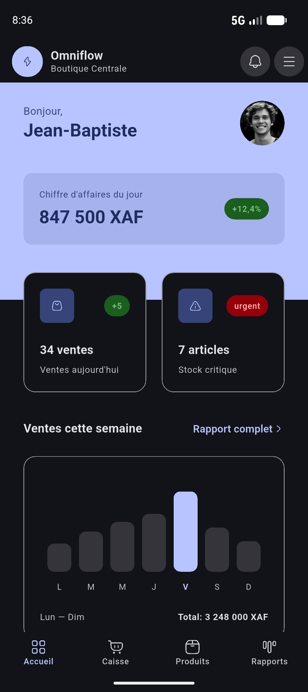
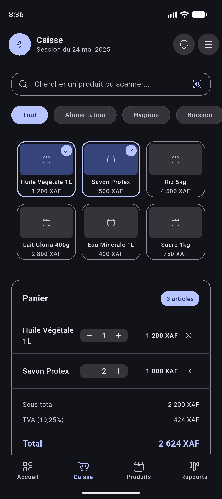
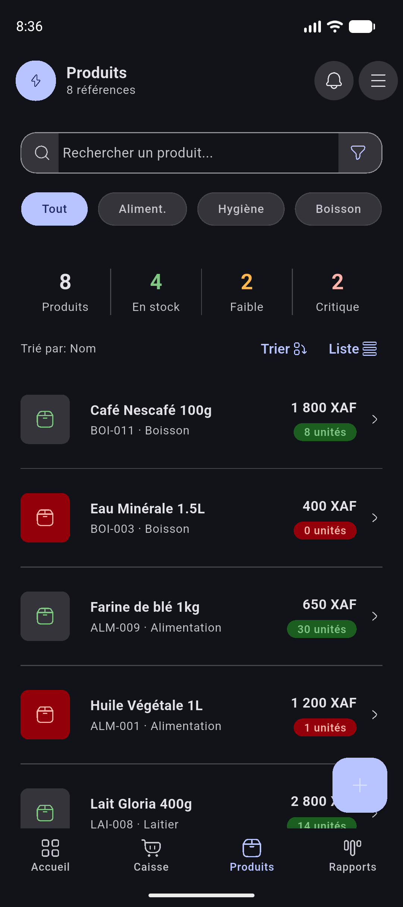
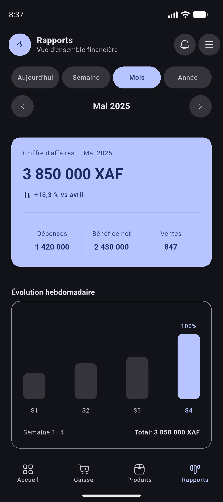

# Omniflow

**Shop management and point of sale for a small business.**
Caisse, catalogue, factures et rapports dans une seule application mobile.

<p>
  
  
  
  
</p>

Captured on an Android emulator from the debug build. The names and amounts on these screens are sample placeholders in the UI, not a live shop.

## What it does

- Sign-in and a short onboarding
- Product catalog
- Checkout at the register
- Invoices
- Reports on the activity of the shop

The interface is aimed at an owner who sells from one place and needs the numbers without a back office.

## Stack

| | |
|---|---|
| App | Flutter, Material 3 |
| State | Riverpod |
| Navigation | go_router |
| Backend | Appwrite (Auth and data), Dio for HTTP |

## Run

Copy the Appwrite project id into a `.env` file at the root (the keys are read with `flutter_dotenv`; they are not committed):

```bash
APPWRITE_ENDPOINT=https://cloud.appwrite.io/v1
APPWRITE_PROJECT_ID=your_project_id
```

```bash
flutter pub get
flutter run
```

## Author

Paul Mbou — [github.com/paul-mbou](https://github.com/paul-mbou)
